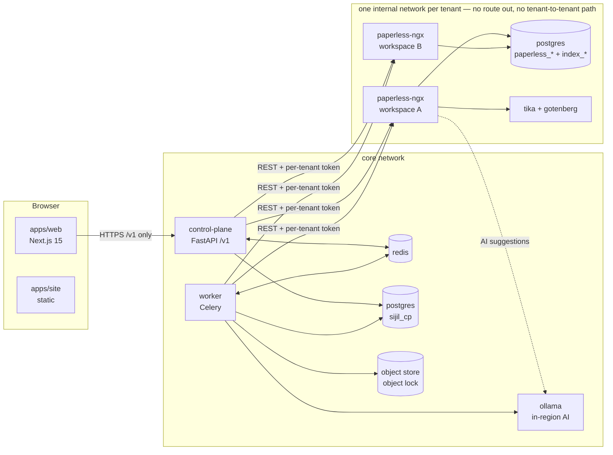
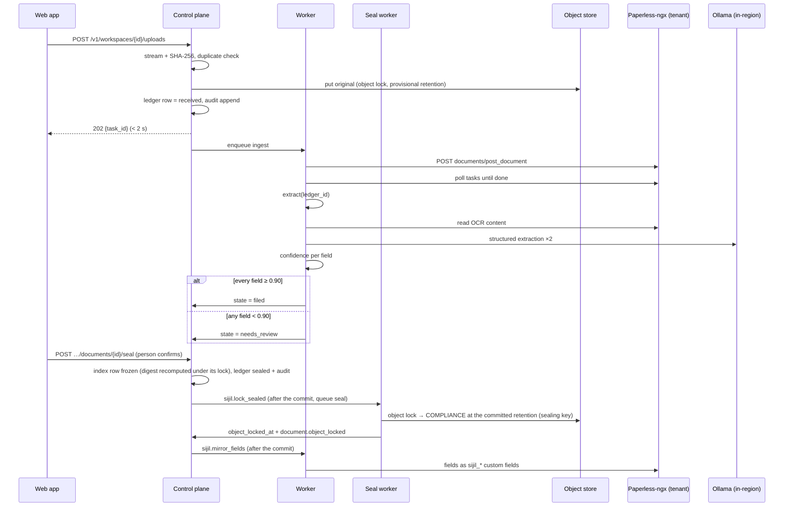

# Sijil architecture

This document describes how the pieces fit together. The *why* behind each decision is in the design ([docs/superpowers/specs/2026-10-31-sijil-mvp-design.md](superpowers/specs/2026-10-31-sijil-mvp-design.md)), and the build order is in [docs/plan.md](plan.md). Where this document and the code disagree, fix one of them.

## Components (one region)



| Component | Owns | Never does |
| --- | --- | --- |
| `apps/web` | UI, translation and RTL rendering | Talk to Paperless-ngx, hold document bytes beyond the current view |
| `control-plane` | Auth, sessions, orgs, workspaces, roles, ledger, audit log, retention, review, exports | Run long jobs (it enqueues them) |
| `worker` | Provisioning (`TenantRuntime`), ingest, task polling, hashing, the Paperless field mirror, the purge of a removed or deleted document's Paperless copy and index rows, the sweeps, eligibility marking, drift check | Serve HTTP to browsers, delete an original |
| `worker-extraction` | Field extraction by the in-region model and routing (queue `extraction`, one at a time) | Provision, hold a Docker socket |
| `worker-seal` | The COMPLIANCE lock after a seal (queue `seal`; the only holder of the sealing key) | Read document bytes or fields, reach a tenant or the AI network |
| `worker-removal` | Deleting an original from the store after a removal or an approved deletion (queue `removal`; the only holder of the removal key) | Read document bytes or fields, change a retention, reach a tenant or the AI network |
| `worker-export` | Building and signing period exports, expiring them after 7 days (queue `export`; the only holder of the export key and the region's signing seed) | Read from Paperless, reach a tenant or the AI network, delete an original |
| `sijil_core` | Settings, region guard, crypto, `PaperlessClient`, field parsers | Import `sijil_cp` or `sijil_worker` |
| Paperless-ngx (per workspace) | OCR, full-text search, original + archive files, matching, AI suggestions | Get modified: it is the official image, configured by environment variables only |

## Trust boundaries

1. **Browser → control plane.** This is the only way in: session cookie, CSRF, rate limits. Every `/v1/workspaces/{id}/…` route goes through, in order: authenticate, then `authorize(user, workspace, action)`, then `assert_region(workspace.region)`, then the handler, then an audit append.
2. **Control plane / worker → tenant networks.** Each tenant has its own internal network (`tenant_<ws>`) and its own Redis.
   - The control plane, the worker and the stateless or shared helpers (Postgres, Tika, Gotenberg, Ollama) are attached to every tenant network, so a tenant can reach them but never another tenant.
   - Tenants publish no ports, have no route out (by name or by raw IP), can't reach another tenant's Paperless-ngx or Redis, and can't log into their Sijil index database.
   - Ollama is on no network with a route out either, so it can't be used as a relay. Models are pulled by a separate on-demand `ollama-pull` service (`make models`).
   - All of the above is smoke-tested.
   - The control plane must never trust a request because of its network origin: tenants can reach it too.
3. **The seal worker.** `worker-seal` (`-Q seal`) is the only running service holding the sealing key, the one credential that can replace a GOVERNANCE lock by COMPLIANCE (product-owner ruling: never the internet-facing control plane). It is on the `core` network only: no tenant or AI network, no published port, no Docker socket, no master key and no provisioner role. It reads the ledger row and the object's retention, never a document's bytes or fields. Smoke-tested and compose-tested.
4. **The removal worker.** `worker-removal` (`-Q removal --concurrency 1`) is the only running service holding the removal key, the one credential that can delete an original (product-owner ruling, 2026-11-03: a worker that does nothing else). Like the seal worker it is on the `core` network only, with no published port, no Docker socket, no master key, no provisioner role and no app or seal key; it reads the ledger row and the object's retention, never a document's bytes or fields. The Paperless and index copies are purged afterwards by the main worker. Smoke-tested and compose-tested; the smoke check also asserts that `worker` and `worker-seal` hold no `SIJIL_OBJECTSTORE_REMOVAL_*`.
5. **Tenant → tenant.** Each tenant has its own database, volumes, Paperless secret key and API token. The control plane holds tokens encrypted with a per-tenant data key, and never lends a token to the browser.

## Where data lives

| Store | Shared? | Holds | Document content? |
| --- | --- | --- | --- |
| `sijil_cp` (Postgres) | Shared per region | Users, orgs, workspaces, memberships, sessions, encrypted tenant credentials, `DocumentLedger` (hashes, states, retention dates), `AuditEvent` | **No** (hashes and metadata only) |
| `index_<ws>` (Postgres + pgvector) | Per workspace | Extracted field values, correction notes, OCR-derived text for Ask, embeddings | Yes |
| `paperless_<ws>` (Postgres) + tenant volumes | Per workspace | Paperless metadata, OCR text, original + archived PDFs (a working copy) | Yes |
| Object store (`sijil-originals`) | Per region, one prefix per workspace | Write-once original of every ingested file, key `{tenant_ref}/{sha256}`, versioned, object lock until `retention_until` | Yes (the record of truth for files) |
| Object store (`sijil-originals-exports`) | Per region, one prefix per workspace | Signed period export ZIPs, plain objects (no lock), deleted 7 days after they are ready | Yes (copies of originals and fields) |
| Redis | Per region | Job queues and results | Transient job arguments only (ids, never file bytes) |

## Document lifecycle



States: `received → needs_review | filed → sealed`, then three terminal ones (M4), each a tombstone row that keeps `sha256` and the object reference: `removed` (before sealing only, by the Owner, with a stated reason and a step-up), and `deleting → deleted` (after retention only, approved by the Owner). Nothing else ever leaves the archive.

### M2 capture: how a file gets in

- **Originals.** `accept_file` streams the body to a spool while computing SHA-256 and MD5, sniffs the type from the content (never the extension or client `Content-Type`), and writes the original to the object store at `{tenant_ref}/{sha256}` (content-addressed, so a repeated put is harmless). The object carries a **GOVERNANCE** lock with a provisional `retain_until`: the end of the arrival's calendar year (region-local date) plus the workspace's lowest policy years across document types (`sijil_core.retention.lowest_policy_years`; `MA`: 10, `DE`: 8). Routing and sealing raise it to the type's own policy, so a type kept for less than `other` really is, and raising one type's policy never raises another's. Retention can only be extended. COMPLIANCE comes at seal (M3, see below).
- **Object-store credentials.** Only the one-shot `migrate` service (and the integration-test runner) holds the RustFS root key. `sijil-cp bootstrap-storage` uses it to create, idempotently through RustFS's admin API, the user `SIJIL_OBJECTSTORE_APP_ACCESS_KEY` with the policy `sijil-app`: `s3:PutObject`, `s3:PutObjectRetention`, `s3:GetObject`, `s3:GetObjectVersion`, `s3:GetObjectRetention` on the originals and `s3:ListBucket` on the bucket, with an explicit deny of `s3:BypassGovernanceRetention`, every delete, legal hold and bucket configuration. The control plane, worker, worker-extraction, smtp and beat use only that key, so even code execution in the internet-facing `smtp` cannot delete or shorten a GOVERNANCE-locked original. `s3:PutObjectRetention` is needed to put an object with a lock (RustFS 1.0.4 refuses a locked put without it); without the bypass permission the store refuses to shorten or replace a GOVERNANCE retention, so it can only extend one. `extend_retention` (filing, M3) works with this key because it only moves a lock later. `seal` needs the bypass, so only the seal worker does it, with its own key (see "M3 review and seal"); deleting an original needs the removal key, which only the removal worker holds (see "M4 removal").
- **Ledger.** One live `document_ledger` row per `(workspace_id, sha256)`: unique among the rows not `removed`, `deleting` or `deleted` (0013's partial index). A tombstone's bytes may be archived again, as a new row and a new object version under the same content key; the tombstone keeps its own row and version id, and the removal worker deletes only by version id. It holds hashes, size, kind, source, object key and version, ingest state and dates, and never a filename, subject or sender. The row `id`, `sha256`, `md5` and the other identity columns are immutable (trigger), even for the table owner, and `sealed_at` / `sealed_by` can be set once and never changed or cleared. A second upload of the same bytes while a live row holds them returns `409 document.duplicate` with that row's id and audits `document.duplicate_rejected`.
- **Audit chain.** The ledger insert and its audit event (`document.uploaded`, or `email.received` for the raw message of an inbound email; its attachments, a forwarded `.eml` included, are `document.uploaded` with actor `email`) commit in one transaction. Ingest, views, lists, integrity checks and org/member changes append to the same per-workspace chain.
- **Ingest (claim, lease, resume).** After commit, `sijil.ingest_document` is enqueued on the `ingest` queue. The worker claims the row with a compare-and-set (`queued`, or `sending` whose lease expired) and stamps `ingest_claimed_at`; a crashed run is taken over once the lease lapses, and a beat task re-queues stranded rows. Before uploading it asks Paperless for the SHA-256: Paperless 3.4.1 accepts duplicate uploads, so an existing document is adopted instead of uploaded again. It then polls Paperless's task until `consumed`, records `paperless_doc_id`, and audits `document.ingested` or `document.ingest_failed`. Every write after the claim is guarded by the lease stamp.
- **Ingest never gives up on a transient cause.** Celery retries a run 8 times (about 30 min). When those run out on a transient cause (Paperless or the workspace unavailable, a consume task still running after the poll timeout, the store or the database unreachable), the row goes back to `queued` with `ingest_next_attempt_at` 1 h ahead, doubling per exhausted cycle (derived from `ingest_attempts`) up to 24 h, and `document.ingest_delayed` is audited once per cycle. The requeue sweep sends it again once that time is over. Only `unsupported` and a non-transient `failed` (the original missing or corrupt in the store, a consume failure Paperless keeps reporting, a refused token) are final. An upload into a workspace that is not `provisioning` or `active` is refused with `409 workspace.not_ready`, before anything is stored.
- **Per-format outcome (Paperless 3.4.1).** Consumed: PDF, JPEG, PNG, TIFF, DOCX, XLSX, EML. XML is refused by Paperless: the original stays archived and counted with `ingest_state = unsupported` (`ingest.unsupported_format`), audited, never retried. The HEIC sample is a bare `ftyp` box that Paperless cannot decode (also `unsupported`); a real HEIC is untested.
- **Inbound SMTP.** The `smtp` service (published on `127.0.0.1:2525` in development, no Docker socket, no tenant network) accepts mail for `{slug}.{inbound_token}@{SIJIL_INBOUND_DOMAIN}`. An unknown recipient is refused at RCPT (`550 5.1.1`), over 100 MB with `552 5.3.4`. The raw `.eml` is archived as a document (`source = email`), and each attachment is archived as its own document linked by `source_email_id`. All of it goes through the same `accept_file`.
- **Drift check.** `sijil.drift_check` runs nightly per active workspace (beat, 02:30). For every ledger row, whatever its ingest state, it checks that the object still exists with the recorded size, and for every `consumed` row also that Paperless still has the document with `original_checksum` equal to the ledger `sha256`. A problem creates one open `IntegrityAlert` per document and kind plus an `integrity.drift` event; a clean run writes `integrity.check_ok`. Paperless being unreachable is retried, and flagged only once the retries run out. A check that cannot run is a finding too, because whoever deleted a document with the admin password can also revoke the service token: a refused token (401/403), a missing or undecryptable credential, an unexpected error response, or exhausted retries open one workspace-level alert (`ledger_id` NULL; kind `engine_forbidden`, `engine_credential_missing`, `engine_bad_response` or `engine_unreachable`) and write `integrity.check_failed` on every run. Metadata of an unexpected shape for one document is a `paperless_bad_metadata` alert for that document, and the run goes on.
- **Reconcile and the subnet pool.** Tenant networks get a `/28` from `SIJIL_TENANT_SUBNET_POOL` (see below), and `reconcile_tenants` re-attaches the shared services after any of them is recreated, so capture keeps reaching tenants.
- **Dev leftovers.** Acceptance runs leave their organisation, user and ledger rows and their GOVERNANCE-locked objects behind on the dev stack (expected: locked objects cannot be deleted before `retain_until`). `make down ARGS=-v` wipes them with the volumes, and first removes the worker-provisioned tenants of the compose project (`infra/scripts/clean-tenants.sh --volumes`: containers and networks labelled `sijil.tenant` on a network labelled `sijil.project=<project>`, and their volumes), which `docker compose down` does not know about. Plain `make down` only stops the compose services: the tenants keep running with their data, because their workspace rows survive in the database, and `make up` re-attaches the shared services to them (reconcile).
- **Try it.** `make seed` signs in as a SAMPLE user, provisions the SAMPLE workspace if needed, uploads `fixtures/invoices/sample-01..06`, emails `sample-07..12` to the workspace address and waits until all are consumed. `test_m2_acceptance` (`make itest`) runs the same flow in a throw-away organisation and checks hashes, consumption within 120 s, the 409 on re-upload, `sijil-cp audit verify`, the immutable `sha256`, and a drift alert after an admin deletes a document in Paperless.

### M3 recognition: extraction and routing

- **Pipeline.** Ingest settles a row `consumed` (or `unsupported`) and then sends `sijil.extract_document` on the queue `extraction`, deduplicated by `extract:pending:<ledger_id>` (Redis `SET NX EX`, 1 h; one message in flight per document). `sijil_worker.extract.extract_document` reads the text Paperless extracted (never the PDF's own text layer), normalises it and keeps the first 12,000 characters, asks the compose `ollama` (the only allowed AI host, `SIJIL_AI_ALLOWED_HOSTS`) twice for the fields (run A and run B: two prompts, two seeds, a JSON schema), parses each value to a canonical string (`sijil_core.fields`: `Decimal` amounts with Arabic-Indic digits and decimal commas, ISO dates, 15-digit ICE), scores each field from its signals (`sijil_core.confidence`: the runs agreeing, Paperless's type match, the value in the text, the supplier already known, the date, VAT and HT + VAT = TTC checks) and routes it: `filed` iff every required field scores at least 0.90 and no flag blocks, else `needs_review`. Routing raises `retention_until` to the fiscal date (object lock first, then the ledger; never lowered) and audits `document.extracted` and `document.filed` / `document.needs_review`, with no field value (ruling P5). Then, best effort, the document gets its title and type in its own Paperless. An `unsupported` row is never extracted: it goes straight to review with `ingest.unsupported_format`.
- **OCR first.** Before the model runs, extraction checks whether another document of the same workspace that arrived in the last 30 min is still `queued` or `sending`; if so the task sends itself again 30 s later as a fresh message (not a retry, so the retry budget is untouched) and keeps its pending key. The model and OCR share the host, and running both made the tenant's consumption miss M2's 120 s budget.
- **Only active workspaces extract.** The task is a no-op for a document of a workspace that is not `active` (`hibernated`, `closing`, `provisioning`, `error`) (nothing read, written or audited), and the sweep below skips them, so a paused or closing workspace never holds the one model. Integration tests mark every workspace they create `closing` at teardown (`tests/support/workspaces.py`): ledger rows cannot be deleted, so an itest workspace left `active` would otherwise feed the live worker for ever.
- **The index database** (`index_<ref>`, one per workspace, its own role and password, `sijil_core.index`). `document_fields`: one row per ledger id with the canonical `values`, per-field `confidence`, `signals` and `source` (`extraction` or `user`), the `flags`, the model, and once sealed `sealed_at` and `fields_sha256`; the trigger `document_fields_frozen` refuses every update and delete of a sealed row, and every delete or truncate at all. `extraction_run`: both raw model answers per document, append-only (evidence). The control plane and the workers reach it through `IndexEngines` (an engine per workspace, built from the sealed `index_db_password` credential). Field values live only here and in the tenant's Paperless, never in `sijil_cp` or the audit log.
- **The extraction worker.** `worker-extraction` runs `sijil_worker.main_extraction` on `-Q extraction --concurrency 1` with `ExtractionSettings` only: the app database role, the broker, the master key (to open the tenant and index credentials), the app object-store key (to extend a lock at filing) and Ollama. No Docker socket, no provisioner role. Ollama runs one generation at a time (`OLLAMA_NUM_PARALLEL=1`, a queue of 8, six CPUs). Every client asks for six threads (`SIJIL_OLLAMA_NUM_THREAD`): Ollama otherwise starts one per host CPU, and eight threads under a six-CPU quota were throttled to 0.4 tokens/s. One run of `qwen3:4b` then takes about 20 s warm (measured; up to ~130 s was seen with the throttled pool), each answer is capped at 1024 tokens, and the client waits up to 300 s. Ollama aborting a degenerate run (HTTP 500 `token repeat limit reached`, deterministic at temperature 0) is that run's bad output, never retried: the other run is used. Transient failures (Ollama or Paperless down, the store unreachable) retry 8 times with jittered back-off (over half an hour), then the document is flagged `extraction_failed` and routed to review: it never waits in `received` for ever.
- **The two sweeps.** `sijil.requeue_unextracted` (beat, every 600 s) re-sends extraction for this region's rows still `received` (and `consumed` or `unsupported`) 15 minutes after arrival, in active workspaces only, oldest first, at most 50 per run, skipping those in flight. `sijil.requeue_unlocked` (beat, every 300 s) re-sends the compliance lock for sealed rows still without `object_locked_at` (see "The commit-to-lock window" below). Both are safe to repeat: an extracted row is never extracted again, a locked row never locked again. A row that can neither be extracted nor recorded as failed (its index database gone) keeps its `extract:pending` key until the 1 h TTL, so the sweep skips it rather than resending it ahead of newer rows every run.
- **Try it.** `make models` pulls the model once (the only Ollama with internet). `make seed` now also waits (with progress) until no seeded document is `received` and prints how many were filed and how many are in review. `make eval WS=<id>` prints per-field accuracy for `fr`, `ar` and all on the SAMPLE set (reported, not gated, read-only). `make acceptance` runs the slow `test_m3_acceptance` (marked `slow`, so `make itest` skips it): a fresh workspace, the 12 invoices plus 6 emails through the model (up to 45 min), the broken totals of `sample-05` and `sample-08` in review, `sample-05` corrected and sealed over the API, then COMPLIANCE on its original at `retention_until` within 120 s, `sijil_sealed = true` in Paperless within 60 s, `409 retention.locked` on a later edit, and the eval table.

### M3 review and seal

- **Review.** `GET /v1/workspaces/{id}/review` lists `needs_review` documents, oldest first, with each field's value, confidence and source read from the workspace's index database (`review.listed`). `GET …/documents/{id}/fields` returns the same item plus `sealed_at` and `fields_sha256` (`document.viewed`). `PATCH …/documents/{id}/fields` parses each value with `sijil_core.fields.parse_field` (`422 field.unknown` / `field.invalid` with the `field`), stores the canonical string with `source = user` and confidence 1.0, and audits `document.fields_edited` with the field names only, never values (ruling P5). A `received` document is `409 document.not_reviewable`; a sealed one `409 retention.locked`. One whose index row is frozen while its ledger is not (a seal that failed half-way) answers `409 seal.incomplete`, and the queue and the fields read show it as `seal_incomplete: true`; sealing it again completes it.
- **Seal order** (`POST …/documents/{id}/seal`, `documents_seal`: Member and up; ruling P7 as amended by the product owner). The control plane holds the ledger row `FOR UPDATE` throughout (taken before the audit chain's lock, as everywhere), and so does a field edit, which commits its `document.fields_edited` event first and its index write after (an applied edit is always audited; an index failure then is `503 field.update_failed`, a logged attempt that did not apply). A seal racing an edit either seals the values it locked, with their digest, or gets `409 seal.fields_changed`:
  1. the ledger row locked and refused unless `filed` or `needs_review` (`409 retention.locked` once sealed, `document.not_reviewable` otherwise); `422 seal.fields_incomplete` lists the required fields that are empty;
  2. the index row frozen by `index.seal_fields`, which recomputes `fields_sha256 = sha256(canonical_json({"v": 1, "fields": every field name → value or null}))` (`sijil_core.fields.fields_digest`; `document_type` is one of the fields; pinned by a golden test, reused by the mirror and exports) from the row it locks `FOR UPDATE`, and refuses (`409 seal.fields_changed`) a digest of values that changed since they were read. The same hash again returns the stored row and its `sealed_at`; another hash on a sealed row is `retention.locked`;
  3. one control-plane transaction: ledger `state = sealed`, `fields_sha256`, `sealed_at` (the index's), `sealed_by`, `retention_until = final` with `final = max(ledger.retention_until, fiscal_retain_until(retention_basis(…), country))`, and `document.sealed` `{fields_sha256, retention_until}`. `sijil_core.retention.retention_basis` is the one basis routing and seal share: a plausible document date, else the arrival date, never after today (ruling P1: never lowered; an implausible year never locks longer);
  4. after the commit, `sijil.lock_sealed` to the seal worker (queue `seal`) and `sijil.mirror_fields` to the main worker (`default`).

  A retry after a failed ledger commit finds the index already sealed with the same hash and completes it, with exactly one `document.sealed`.
- **The compliance lock** (`sijil_worker.lock`, the seal worker). `lock_sealed` asserts the region, does nothing unless the ledger is sealed and `object_locked_at` is unset, calls `store.seal(ref, ledger.retention_until)` with the committed value (never recomputed; idempotent at the same date, a COMPLIANCE lock only ever extended), then sets `object_locked_at` (0009: once, never changed, only on a sealed row) and audits `document.object_locked` `{retention_until}` in one transaction holding the ledger row `FOR UPDATE`. Transient store errors are retried with back-off; a permanent refusal is logged by its code and left to the sweep and the drift check.
- **The commit-to-lock window.** Between the seal commit and the lock, the original stays under GOVERNANCE at its provisional date; no app key can delete it or shorten that lock. `sijil.requeue_unlocked` (beat, every 300 s, on the main worker) re-sends the lock for this region's sealed rows still unlocked two minutes after the seal, at most 50 a run, deduplicated with `lock:pending:<id>` (Redis `SET NX EX`, like extraction). The nightly drift check raises `object_lock_pending` for a row still unlocked an hour after its seal, and `object_lock_mismatch` for a locked row whose object is not COMPLIANCE or is retained for less than `retention_until` (read with `GetObjectRetention`, which the app key holds).
- **Mirror.** `sijil.mirror_fields` sets `sijil_supplier`, `sijil_ice`, `sijil_number`, `sijil_date`, `sijil_total_ht`, `sijil_vat`, `sijil_total_ttc` (monetary, `MAD1500.00`) and `sijil_sealed`, and the document type, in the tenant's own Paperless, keeping the tenant's other custom fields, and audits `document.fields_mirrored` (a count, no values). It recomputes the digest from the index values first: a mismatch with the ledger copies nothing, logs `mirror.hash_mismatch` and raises a `fields_hash_mismatch` alert. A workspace that is not active is retried later. A broker that is down when the seal commits only delays this copy (nothing re-sends it yet).
- **Seal batch.** `POST …/seal-batch {"month": "YYYY-MM", "cursor"?}` seals the month's `filed` documents (region-local arrival), oldest first, at most 500 per call, each through the same code in its own transaction. A document that fails is rolled back and listed in `skipped: [{id, code}]` (`seal.fields_incomplete`, `seal.fields_changed`, `seal.index_unavailable`, `retention.locked`, …) while the others go on; only a workspace-level failure (its index database unreachable: `503 seal.index_unavailable`) aborts. `next_cursor` (the last attempted document) lets the client move past rows that keep failing, and `remaining` counts the month's filed documents after it.
- **The sealing key.** Switching GOVERNANCE to COMPLIANCE needs `s3:BypassGovernanceRetention` in RustFS 1.0.4, which the app key is denied. `migrate` provisions a second user, `SIJIL_OBJECTSTORE_SEAL_ACCESS_KEY` (policy `sijil-seal`): `s3:GetObjectRetention`, `s3:PutObjectRetention` and the bypass, with an explicit deny of every delete, legal hold, bucket configuration and of reading or writing object bytes. Only `worker-seal` holds it (trust boundary 3). With the bypass it could shorten an *unsealed* original's GOVERNANCE retention, never delete one; a COMPLIANCE lock can be neither shortened nor replaced by anyone.

### M4 retention, removal and deletion

- **Who holds which object-store key.** One key per job, each held by one service; the root key only by the one-shot `migrate` (and the integration-test runner).

  | Key | Policy | Held by | Can | Can never |
  | --- | --- | --- | --- | --- |
  | app | `sijil-app` | control plane, `worker`, `worker-extraction`, `smtp`, `beat` | put an original with a GOVERNANCE lock, read it, extend a lock; read an export | delete anything, shorten a lock, write an export |
  | seal | `sijil-seal` | `worker-seal` | replace a GOVERNANCE lock by COMPLIANCE | delete, read or write bytes |
  | removal | `sijil-removal` | `worker-removal` | delete a GOVERNANCE version (pre-seal removal) or an expired one (approved deletion) | read or write bytes, change a retention, delete a COMPLIANCE version before its date, leave a delete marker |
  | export | `sijil-export` | `worker-export` | read originals; put, read and delete exports in `<bucket>-exports` | write or delete an original, change a retention |

  The export worker also holds the region's Ed25519 signing seed (`SIJIL_EXPORT_SIGNING_KEY`); the control plane holds only the public key. Each holder is compose-tested (`tests/integration/test_removal_key.py`, `test_export_key.py`) and smoke-tested.
- **The Owner's pre-seal removal** (a document uploaded by mistake, design §5.4). `POST …/documents/{id}/remove` `{reason}` (`documents_remove`: the Owner only; a TOTP step-up within 10 minutes; a reason of 10 to 1000 characters) holds the ledger row `FOR UPDATE`, refuses a terminal row (`409 document.not_removable`) and a sealed one, or one whose index row is frozen by a half-done seal (`409 document.sealed_cannot_be_removed`), then makes the row its tombstone (`state = removed`, `removed_at`, `removed_by`, `removal_reason`; 0011 allows exactly this from `received`, `needs_review` or `filed`) and audits `document.removed` `{reason_length}` (never the reason). After the commit it sends `sijil.remove_original` to `worker-removal` (below), which deletes the original with the GOVERNANCE bypass and then sends `sijil.purge_document` to the main worker.
- **The purge** (`sijil_worker.purge`, main worker: it holds the master key). Only for a `removed` or `deleted` row whose `original_removed_at` is set. In the tenant's Paperless it works with the tenant admin's credential (the service user has no delete right, and keeps none): it finds every copy (the ledger's id, the consume task's document, every live document with the SHA-256, every trashed one with ingest's file name), keeping only listed rows that are copies (their `checksum` is the SHA-256, or, when the payload has none, their file name is ingest's: never Paperless's filter alone) and leaving the copy a live re-upload of the same bytes recorded (waiting while that re-upload is still ingesting), refuses with an error and deletes nothing when more than 10 match (the sweep tries again an hour later), deletes them and empties them from the trash, and waits (bounded, 24 h by our own clock) for a consume that may still produce a copy. Then `index.purge_document` deletes the index rows through the schema's one gated DELETE (`purge_document()` opens `sijil.purge` for that ledger id only; a sealed row also needs `sijil.purge_sealed`, set only for `deleted`), and `document.purged` `{paperless}` is audited once Paperless keeps no copy. `sijil.requeue_unpurged` re-sends it for rows that never recorded it. Ingest and extraction both stop on a row removed while they ran.
- **Corrections on sealed documents.** A sealed document is never edited: `POST …/documents/{id}/corrections` `{field, value, reason}` (Member and up) appends a note to the index's `correction_note` (append-only, index schema v2) and audits `document.corrected` with the field name only. The sealed row, `fields_sha256` and the ledger stay as they were; exports show the latest note per field as the effective value and flag it in `corrected_fields`.
- **The removal key.** `migrate` provisions a third user, `SIJIL_OBJECTSTORE_REMOVAL_ACCESS_KEY` (policy `sijil-removal`): `s3:GetObjectRetention`, `s3:DeleteObjectVersion` and `s3:BypassGovernanceRetention` on the originals, with an explicit deny of `s3:PutObject`, `s3:GetObject`, `s3:GetObjectVersion`, `s3:PutObjectRetention`, legal hold, the unversioned `s3:DeleteObject` (a delete marker) and every bucket configuration. It can delete a version under GOVERNANCE (an unsealed original) or one whose lock has expired; it can never read bytes, write, or change a retention, and nobody can delete a COMPLIANCE version before its date. Only `worker-removal` holds it (trust boundary 4). `make up` appends keys added to `.env.example` since an existing `.env` was made.
- **`sijil.remove_original(ledger_id, workspace_id)`** (`sijil_worker.removal`, queue `removal`). It asserts the region and holds the ledger row `FOR UPDATE` (before the audit chain's lock) throughout. Only `removed` (the Owner's pre-seal removal: delete with the GOVERNANCE bypass) or `deleting` (an approved deletion after retention: delete without the bypass) with `original_removed_at` still NULL proceeds; any other state is logged and left alone, so a forged or stale message never deletes. `ObjectStore.remove_original(ref, governance=…)` reads the lock first and refuses (`RetentionActive`, no delete sent) a version COMPLIANCE-locked until today or later; the store refuses it too. An absent version counts as already removed, so a crash between the delete and the commit only repeats the delete. Then `original_removed_at` is set (from `deleting` also `state = deleted` and `deleted_at`; 0011 allows exactly these writes), `document.original_removed` `{mode: "governance" | "expired"}` is audited, the transaction commits, and `sijil.purge_document` is sent to the main worker (`default`) for the Paperless copy and the index rows.
- **Failures.** Transient store or database errors are retried 8 times with jittered back-off (30 s doubling, capped at 15 min; the M3 classification). A final failure (retries spent, or a refusal such as `AccessDenied` or `retention.locked`) is audited `document.removal_failed` `{code}` and the state stays as it is. Its `remove:pending:<id>` key is then kept for its full hour, recorded or not, so a row that keeps failing is re-sent at most hourly instead of every sweep.
- **The sweep.** `sijil.requeue_unremoved` (beat, every 300 s, on the main worker: it only reads the ledger and sends tasks) re-sends `remove_original` for this region's `removed` and `deleting` rows with `original_removed_at IS NULL`, in any workspace state, oldest decision first, at most 50 a run, deduplicated with `remove:pending:<id>` (`SET NX EX`, 1 h).
- **End of retention: nothing is purged automatically.** `sijil.mark_eligible` (beat, 02:00 Casablanca, main worker; `sijil_worker.eligibility`) sets `deletion_eligible_at` (a marker, set once) on this region's rows whose `retention_until` is before the region-local date (`sijil_core.retention.region_local_date`, the rule of `sijil_region_today()`), not `removed`, `deleting` or `deleted`, and audits one `retention.eligible` `{count}` per workspace when the count is above 0; it changes nothing else. `GET …/retention/eligible` (`retention_manage`) lists eligible rows, oldest `retention_until` first. `POST …/retention/approve-deletion` `{ids}` (1 to 500) needs `retention_approve_deletion` (Owner only) and a step-up within 10 minutes; it locks the rows `FOR UPDATE` in id order and is all or nothing (`409 retention.not_eligible` with the offending `ids`). It sets `state = deleting`, `deletion_approved_at/by`, audits `document.deletion_approved` per row and `retention.deletion_batch` `{count}` in one transaction, then claims `remove:pending:<id>` and sends `remove_original` for each. Every refusal of either Owner route (removal or approval) to a signed-in member is audited `document.removal_refused` `{code}` in its own transaction (`sijil_cp.removals`).

## Retention lock: four layers

| # | Layer | Stops |
| --- | --- | --- |
| 1 | Control-plane API refuses with `409 retention.locked` | Every UI and API path we build |
| 2 | Paperless service user has no delete permission | Anyone holding the per-tenant token |
| 3 | Database triggers. `document_ledger` (0004/0006/0008/0011) rejects every row delete, changes to the identity columns and, once sealed, any change to `fields_sha256`, `retention_until`, `sealed_at` or `sealed_by`; its state moves only along the allowed transitions (`sealed → removed` never; `deleting` only once `retention_until` is before `sijil_region_today()`), and a row is never inserted in a terminal state. The CHECKs `ck_document_ledger_seal_consistent` and `ck_document_ledger_terminal_consistent` keep each state's columns together. The index row (`document_fields_frozen`) refuses every update of a sealed row and every delete but the purge's gated one | Bugs in our own code, direct SQL as the app role or the table owner |
| 4 | Object lock on the original: GOVERNANCE while unsealed (provisional retention), COMPLIANCE once sealed. One key per job: the app key can never delete nor shorten; the seal key can replace a GOVERNANCE lock (so shorten an unsealed one) but deletes nothing; the removal key can delete an unsealed version or an expired one; no key deletes or shortens COMPLIANCE before its date | Anything touching storage. A nightly drift check catches changes made inside Paperless-ngx |

Every one of these has its own test in `tests/retention/` (the lock suite), which `make check` runs; the parts against RustFS and a live tenant run in `make itest`:

- `test_lock_all_paths.py` is the proof of M4's acceptance ("a document under retention cannot be deleted by any role via UI or API"): roles {Owner, Admin, Member, ReadOnly} × paths × {sealed, unsealed}. The paths are the removal, a `DELETE …/documents/{id}` (no such route: 405), the field edit, the approval of a deletion before retention ends, the Paperless delete with the tenant service token, direct SQL on the ledger (`DELETE`, `sha256`, a bare `removed`, `fields_sha256`, as the app role and the table owner), the object-store delete with the app, seal and removal keys, and direct SQL on the index without the purge gate. Every combination is refused for a sealed document; for an unsealed one only the Owner's removal succeeds (and the review edit, which a seal ends). A refused API path writes nothing to the ledger, the index or the store, and a refused removal or approval is audited `document.removal_refused` `{code}`.
- `test_seal_lock.py` (the four layers once sealed, and routing: it only ever raises retention, extends the object lock before the ledger, and never moves a sealed document), `test_terminal_states.py` (0011), `test_removal_paths.py`, `test_removal_worker.py`, `test_purge_paths.py`, `test_deletion_paths.py`, `test_corrections_leave_seal.py` and `test_policy_never_lowers.py`.

A new code path that can change or delete a document must add itself to that suite.

## Audit chain

```
hash_n = sha256( prev_hash_n ‖ canonical_json(event_n) )
prev_hash_0 = "0" × 64
canonical_json = sorted keys, no whitespace, UTF-8, timestamps ISO-8601 UTC with "Z"
```

- There is one chain per workspace. Appends take a per-workspace Postgres advisory lock, so concurrent writers can't fork the chain.
- Two database roles:
  - `sijil_cp_owner` owns the schema and runs only in the one-shot `migrate` service.
  - The API and worker connect as `sijil_cp_app`, which can't create, alter or drop tables, triggers or grants (smoke-tested).
- The `audit_event` migration revokes `UPDATE` and `DELETE` from `sijil_cp_app`, and a trigger rejects them as defence in depth.
- `sijil-cp audit verify --workspace <id>` walks the chain. Export integrity reports include the chain head.

## Period export (M4, ARC-5)

- Built by `worker-export` alone. It reads originals from the object store with the read-only export key (never from Paperless), holds the region's Ed25519 signing seed, sits on `core` only and has no Docker socket. The control plane streams a ready ZIP with the app key (read-only on `<bucket>-exports`), and `GET /v1/regions/{region}/export-key` publishes the public key.
- A document is in the period when its retention basis (the plausible document date, else the region-local arrival date) falls in it. `received`, `needs_review`, `filed` and `sealed` documents are included; `removed`, `deleting` and `deleted` ones are not.
- The ZIP holds:
  - `originals/<ledger_id>.<ext>`, hashed while streamed; a mismatch with the ledger fails the export (`export.hash_mismatch`);
  - `index.csv`:
    - UTF-8 with a BOM, **`;` as separator** (French-locale Excel, fr-MA, opens it in columns), CRLF, RFC 4180 quoting; no `sep=` line, which makes Excel drop the BOM;
    - columns `document_id;state;sha256;size_bytes;content_kind;source;ingested_at;sealed_at;fields_sha256;retention_until`, then every field name (its effective value: the latest correction note wins), then `corrected_fields` (names joined with `;`, so quoted);
    - a free-text value (`supplier_name`, `number`) starting with `=`, `+`, `-`, `@`, TAB or CR gets a leading `'` so a spreadsheet shows it instead of running it; ids, hashes, states, dates, canonical amounts and `corrected_fields` are never changed;
  - `integrity-report.json`: canonical JSON `{v, workspace_id, region, period, generated_at, documents: [{id, path, sha256, size_bytes, fields_sha256}], index_csv_sha256, audit_head: {id, hash}, key_id}`. `index_csv_sha256` is the hash of the file as written (escaped). `key_id` is the first 16 hex characters of the SHA-256 of the raw public key;
  - `integrity-report.json.sig`: base64 of the raw 64-byte Ed25519 signature over the report's exact bytes.
- `sijil-cp export verify <zip> [--public-key B64] [--against-ledger]` prints `ok` or one problem code per line: `signature.invalid`, `key_id.mismatch`, `file.missing:<path>`, `file.extra:<path>`, `file.hash:<path>`, `index_csv.hash`, `zip.invalid`, `ledger.mismatch:<id>`.
- **Try it.** `test_m4_acceptance` (`make itest`, no model: the fields are seeded straight into the index) runs the milestone end to end: a fresh workspace, 4 SAMPLE invoices through the API, two sealed; the Owner's removal of an unsealed one leaves only the tombstone within 120 s (original, Paperless copy and index rows gone, `sha256` kept); no role removes a sealed one; a correction note on a sealed one; the month's export downloaded, verified against the published key and `--against-ledger`, its CSV flagging the corrected field and without the removed document; one tampered byte fails verification; `sijil-cp audit verify` passes.

## Region enforcement

- Every service starts with `SIJIL_REGION`. Settings won't load without it (`sijil_core.settings.CoreSettings`).
- `Organisation.region` is set at signup and can't be changed (DB trigger + API `409 org.region_immutable`, M1).
- Every workspace-scoped request and job calls `sijil_core.region.assert_region(workspace.region, settings)`, which raises `RegionMismatch` (`region.mismatch`).
- AI and OCR endpoints are in-region services only (the compose `ollama` and Paperless's Tesseract). Tests assert that extraction calls no other host (M3).
- Tests run a fake second region (`eu-fra`) to prove that cross-region access is refused.

## `TenantRuntime` lifecycle (M1)

```
provision(workspace) → creates network tenant_<ws> (internal) + redis on it, databases paperless_<ws>
                       and index_<ws> (separate roles and passwords), volumes, container on tenant_<ws>;
                       attaches control plane, worker and shared helpers to tenant_<ws>
                     → waits for health → creates service user (view/add/change, no delete)
                       and read-only support user → takes token → stores it encrypted
                     → workspace.state = active
start / stop         → hibernate idle tenants (spec: after 30 min; post-MVP)
status               → provisioning | active | hibernated | closing | error
destroy              → only after closure rules allow it (design §5.4)
```

`DockerRuntime` drives the Docker Engine API in development. A Kubernetes implementation of the same interface comes with the production milestone.

What `DockerRuntime` creates for a workspace with tenant ref `<ref>` (compose project `<project>`, default `sijil`). The ref is `t` + 16 lower-case base32 characters of SHA-256 over the workspace id (`sijil_core.tenancy.tenant_ref`): short, opaque and fixed for the workspace's life. The name-derived slug is for display and URLs only, so no resource name grows with, or reveals, the organisation's name; container names (their hostnames) are checked to be one DNS label of at most 63 characters before anything is created:

| Resource | Name | Notes |
| --- | --- | --- |
| Network | `<project>_tenant_<ref>` | `internal: true`. A pre-existing network that isn't internal is refused |
| Subnet | a `/28` from `SIJIL_TENANT_SUBNET_POOL` (`10.240.0.0/16`) | First free /28 overlapping no existing Docker network, allocated under a process-local lock (a clash with another process is retried). Docker's default pools allow only about 31 networks. Existing networks keep their subnet |
| Redis | `<project>-paperless-redis-<ref>` | On the tenant network only |
| Paperless-ngx | `<project>-paperless-<ref>` | The official image, the same base env as `infra/compose/paperless/tenant.env` (a unit test keeps them equal), no published port. URL `http://<project>-paperless-<ref>:8000` |
| Volumes | `<project>_<ref>_data`, `<project>_<ref>_media` | Per tenant |
| Tessdata | `<project>_tessdata`, mounted read-only | Filled once by the one-shot `tessdata-init` service: the image's languages plus `infra/compose/tessdata/ara.traineddata`. The sample tenants mount it too |
| Databases | `paperless_<ref>` and `index_<ref>` (unique in `workspace`), each owned by a role of the same name | `REVOKE ALL … FROM PUBLIC`; the index DB is cloned from `template_index` (pgvector) |

- **Labels.** Every container, network and volume carries `sijil.tenant=<ref>`, `sijil.workspace=<id>` and `sijil.role` (`paperless`, `redis`, `network`, `data`, `media`). `destroy` and `make smoke` find tenants by these labels. Labels never carry secrets; secrets go only into the container environment, as for the compose tenants.
- **Extraction has its own worker.** The compose `worker-extraction` consumes only the `extraction` queue with `--concurrency 1` (the model is CPU-bound: one request at a time, 300 s each at most; Ollama gets six CPUs), and the main `worker` no longer consumes it, so ingest never waits behind the model. It has no Docker socket: it provisions nothing.
- **Attached services.** The compose `control-plane`, `worker`, `worker-extraction`, `postgres`, `tika`, `gotenberg` and `ollama` containers (found by their compose labels) are connected to the tenant network with their service name as alias, so the tenant resolves `postgres`, `tika`, … and nothing else. Recreating one of these containers (e.g. `docker compose up` after a rebuild) drops the attachment, and nothing re-runs `ensure_running` for an already active tenant today, so the recreated service can no longer reach existing tenants (or they it) until each is re-provisioned. `sijil_worker.reconcile.reconcile_tenants` fixes that: the worker runs it at start-up and the `beat` service every 300 s (task `sijil.reconcile_tenants`). It connects each missing service to every `label=sijil.tenant` network, is idempotent, and logs and skips a network it can't fix.
- **Provisioner role.** The worker creates tenant roles and databases as `sijil_provisioner` (`LOGIN CREATEDB CREATEROLE`, not superuser, created by `infra/compose/postgres/init.sh`). On PG 16+ it administers only the roles it created, and `createrole_self_grant = 'set'` lets it `SET ROLE` to them (to give them their databases and drop them) without inheriting their rights. Identifiers are checked against `^[a-z0-9_]{1,63}$` and quoted by Postgres's `format('%I')`.
- **Docker socket.** The worker mounts `/var/run/docker.sock` in development only. That is root on the host, which is one reason production uses another runtime.
- **Idempotency.** Every step is get-or-create, passwords are reset on each run, and `destroy` removes containers, network, volumes, databases and roles, ignoring whatever is already gone.

## Local development

`make up` boots the stack in `infra/compose/`. The two sample tenants (`paperless-t1`, `paperless-t2`) exist so the stack can be demoed straight away, and real signups provision their own. `make smoke` checks:

- the control plane is ready and in region `ma-cas`;
- both tenants answer from inside, have no published port, have Arabic OCR and have no route out;
- every running provisioned tenant (label `sijil.tenant`) passes the same checks and can't reach `paperless-t1`;
- Ollama, the object store and the worker all answer.

The object store in development is RustFS (Apache-2.0, S3 API with object lock). MinIO stopped publishing images in 2025. Production uses the region's own object storage behind the same `ObjectStore` interface.
