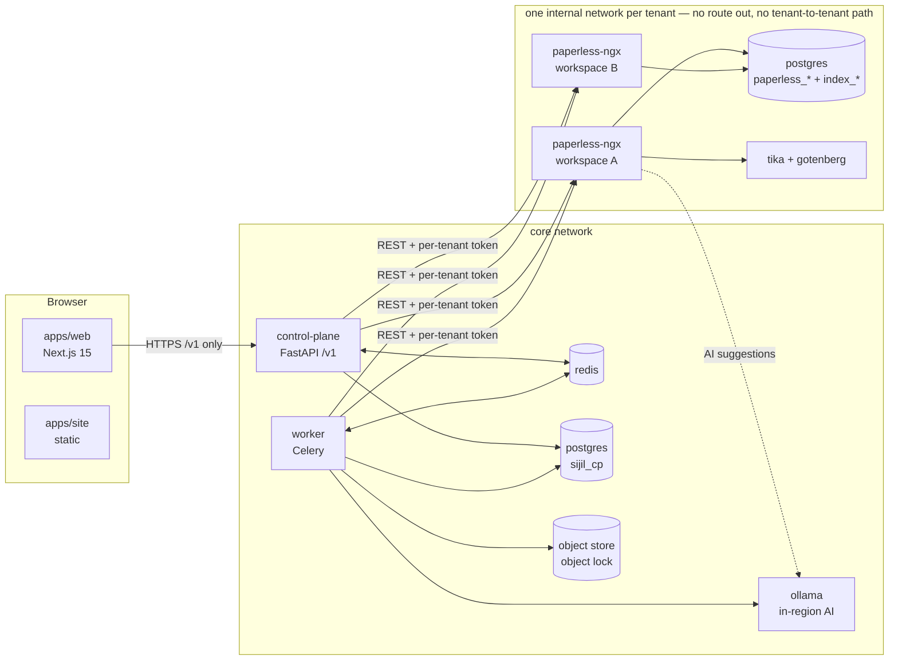
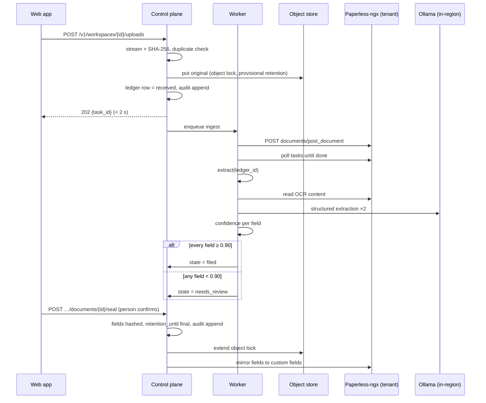

# Sijil architecture

This document describes how the pieces fit together. The *why* behind each decision is in the design ([docs/superpowers/specs/2026-10-31-sijil-mvp-design.md](superpowers/specs/2026-10-31-sijil-mvp-design.md)), and the build order is in [docs/plan.md](plan.md). Where this document and the code disagree, fix one of them.

## Components (one region)



| Component | Owns | Never does |
| --- | --- | --- |
| `apps/web` | UI, translation and RTL rendering | Talk to Paperless-ngx, hold document bytes beyond the current view |
| `control-plane` | Auth, sessions, orgs, workspaces, roles, ledger, audit log, retention, review, exports | Run long jobs (it enqueues them) |
| `worker` | Provisioning (`TenantRuntime`), ingest, task polling, hashing, extraction, drift check, export building | Serve HTTP to browsers |
| `sijil_core` | Settings, region guard, crypto, `PaperlessClient`, field parsers | Import `sijil_cp` or `sijil_worker` |
| Paperless-ngx (per workspace) | OCR, full-text search, original + archive files, matching, AI suggestions | Get modified: it is the official image, configured by environment variables only |

## Trust boundaries

1. **Browser → control plane.** This is the only way in: session cookie, CSRF, rate limits. Every `/v1/workspaces/{id}/…` route goes through, in order: authenticate, then `authorize(user, workspace, action)`, then `assert_region(workspace.region)`, then the handler, then an audit append.
2. **Control plane / worker → tenant networks.** Each tenant has its own internal network (`tenant_<ws>`) and its own Redis.
   - The control plane, the worker and the stateless or shared helpers (Postgres, Tika, Gotenberg, Ollama) are attached to every tenant network, so a tenant can reach them but never another tenant.
   - Tenants publish no ports, have no route out (by name or by raw IP), can't reach another tenant's Paperless-ngx or Redis, and can't log into their Sijil index database.
   - Ollama is on no network with a route out either, so it can't be used as a relay. Models are pulled by a separate on-demand `ollama-pull` service (`make models`).
   - All of the above is smoke-tested.
   - The control plane must never trust a request because of its network origin: tenants can reach it too.
3. **Tenant → tenant.** Each tenant has its own database, volumes, Paperless secret key and API token. The control plane holds tokens encrypted with a per-tenant data key, and never lends a token to the browser.

## Where data lives

| Store | Shared? | Holds | Document content? |
| --- | --- | --- | --- |
| `sijil_cp` (Postgres) | Shared per region | Users, orgs, workspaces, memberships, sessions, encrypted tenant credentials, `DocumentLedger` (hashes, states, retention dates), `AuditEvent` | **No** (hashes and metadata only) |
| `index_<ws>` (Postgres + pgvector) | Per workspace | Extracted field values, correction notes, OCR-derived text for Ask, embeddings | Yes |
| `paperless_<ws>` (Postgres) + tenant volumes | Per workspace | Paperless metadata, OCR text, original + archived PDFs (a working copy) | Yes |
| Object store (`sijil-originals`) | Per region, one prefix per workspace | Write-once original of every ingested file, key = SHA-256, object lock until `retention_until` | Yes (the record of truth for files) |
| Redis | Per region | Job queues and results | Transient job arguments only (ids, never file bytes) |

## Document lifecycle



States: `received → needs_review | filed → sealed`. A document can also become `removed` (a tombstone row), but only before sealing, only by an Owner, and only with a stated reason.

## Retention lock: four layers

| # | Layer | Stops |
| --- | --- | --- |
| 1 | Control-plane API refuses with `409 retention.locked` | Every UI and API path we build |
| 2 | Paperless service user has no delete permission | Anyone holding the per-tenant token |
| 3 | Database trigger on `document_ledger` rejects changes to sealed rows and all row deletes | Bugs in our own code, direct SQL as the app role |
| 4 | Object lock (compliance mode) on the original | Anything touching storage. A nightly drift check catches changes made inside Paperless-ngx |

Every one of these has its own test in `tests/retention/` (M4). A new code path that can change or delete a document must add itself to that suite.

## Audit chain

```
hash_n = sha256( prev_hash_n ‖ canonical_json(event_n) )
prev_hash_0 = "0" × 64
canonical_json = sorted keys, no whitespace, UTF-8, timestamps ISO-8601 UTC with "Z"
```

- There is one chain per workspace. Appends take a per-workspace Postgres advisory lock, so concurrent writers can't fork the chain.
- Two database roles:
  - `sijil_cp_owner` owns the schema and runs only in the one-shot `migrate` service.
  - The API and worker connect as `sijil_cp_app`, which can't create, alter or drop tables, triggers or grants (smoke-tested).
- The `audit_event` migration revokes `UPDATE` and `DELETE` from `sijil_cp_app`, and a trigger rejects them as defence in depth.
- `sijil-cp audit verify --workspace <id>` walks the chain. Export integrity reports include the chain head.

## Region enforcement

- Every service starts with `SIJIL_REGION`. Settings won't load without it (`sijil_core.settings.CoreSettings`).
- `Organisation.region` is set at signup and can't be changed (DB trigger + API `409 org.region_immutable`, M1).
- Every workspace-scoped request and job calls `sijil_core.region.assert_region(workspace.region, settings)`, which raises `RegionMismatch` (`region.mismatch`).
- AI and OCR endpoints are in-region services only (the compose `ollama` and Paperless's Tesseract). Tests assert that extraction calls no other host (M3).
- Tests run a fake second region (`eu-fra`) to prove that cross-region access is refused.

## `TenantRuntime` lifecycle (M1)

```
provision(workspace) → creates network tenant_<ws> (internal) + redis on it, databases paperless_<ws>
                       and index_<ws> (separate roles and passwords), volumes, container on tenant_<ws>;
                       attaches control plane, worker and shared helpers to tenant_<ws>
                     → waits for health → creates service user (view/add/change, no delete)
                       and read-only support user → takes token → stores it encrypted
                     → workspace.state = active
start / stop         → hibernate idle tenants (spec: after 30 min; post-MVP)
status               → provisioning | active | hibernated | closing | error
destroy              → only after closure rules allow it (design §5.4)
```

`DockerRuntime` drives the Docker Engine API in development. A Kubernetes implementation of the same interface comes with the production milestone.

What `DockerRuntime` creates for a workspace with tenant ref `<ref>` (compose project `<project>`, default `sijil`). The ref is `t` + 16 lower-case base32 characters of SHA-256 over the workspace id (`sijil_core.tenancy.tenant_ref`): short, opaque and fixed for the workspace's life. The name-derived slug is for display and URLs only, so no resource name grows with, or reveals, the organisation's name; container names (their hostnames) are checked to be one DNS label of at most 63 characters before anything is created:

| Resource | Name | Notes |
| --- | --- | --- |
| Network | `<project>_tenant_<ref>` | `internal: true`. A pre-existing network that isn't internal is refused |
| Redis | `<project>-paperless-redis-<ref>` | On the tenant network only |
| Paperless-ngx | `<project>-paperless-<ref>` | The official image, the same base env as `infra/compose/paperless/tenant.env` (a unit test keeps them equal), no published port. URL `http://<project>-paperless-<ref>:8000` |
| Volumes | `<project>_<ref>_data`, `<project>_<ref>_media` | Per tenant |
| Tessdata | `<project>_tessdata`, mounted read-only | Filled once by the one-shot `tessdata-init` service: the image's languages plus `infra/compose/tessdata/ara.traineddata`. The sample tenants mount it too |
| Databases | `paperless_<ref>` and `index_<ref>` (unique in `workspace`), each owned by a role of the same name | `REVOKE ALL … FROM PUBLIC`; the index DB is cloned from `template_index` (pgvector) |

- **Labels.** Every container, network and volume carries `sijil.tenant=<ref>`, `sijil.workspace=<id>` and `sijil.role` (`paperless`, `redis`, `network`, `data`, `media`). `destroy` and `make smoke` find tenants by these labels. Labels never carry secrets; secrets go only into the container environment, as for the compose tenants.
- **Attached services.** The compose `control-plane`, `worker`, `postgres`, `tika`, `gotenberg` and `ollama` containers (found by their compose labels) are connected to the tenant network with their service name as alias, so the tenant resolves `postgres`, `tika`, … and nothing else. Recreating one of these containers (e.g. `docker compose up` after a rebuild) drops the attachment, and nothing re-runs `ensure_running` for an already active tenant today, so the recreated service can no longer reach existing tenants (or they it) until each is re-provisioned. A reconciler that re-attaches compose services to every `label=sijil.tenant` network is a known gap, tracked as the first M2 task.
- **Provisioner role.** The worker creates tenant roles and databases as `sijil_provisioner` (`LOGIN CREATEDB CREATEROLE`, not superuser, created by `infra/compose/postgres/init.sh`). On PG 16+ it administers only the roles it created, and `createrole_self_grant = 'set'` lets it `SET ROLE` to them (to give them their databases and drop them) without inheriting their rights. Identifiers are checked against `^[a-z0-9_]{1,63}$` and quoted by Postgres's `format('%I')`.
- **Docker socket.** The worker mounts `/var/run/docker.sock` in development only. That is root on the host, which is one reason production uses another runtime.
- **Idempotency.** Every step is get-or-create, passwords are reset on each run, and `destroy` removes containers, network, volumes, databases and roles, ignoring whatever is already gone.

## Local development

`make up` boots the stack in `infra/compose/`. The two sample tenants (`paperless-t1`, `paperless-t2`) exist so the stack can be demoed straight away, and real signups provision their own. `make smoke` checks:

- the control plane is ready and in region `ma-cas`;
- both tenants answer from inside, have no published port, have Arabic OCR and have no route out;
- every running provisioned tenant (label `sijil.tenant`) passes the same checks and can't reach `paperless-t1`;
- Ollama, the object store and the worker all answer.

The object store in development is RustFS (Apache-2.0, S3 API with object lock). MinIO stopped publishing images in 2025. Production uses the region's own object storage behind the same `ObjectStore` interface.
