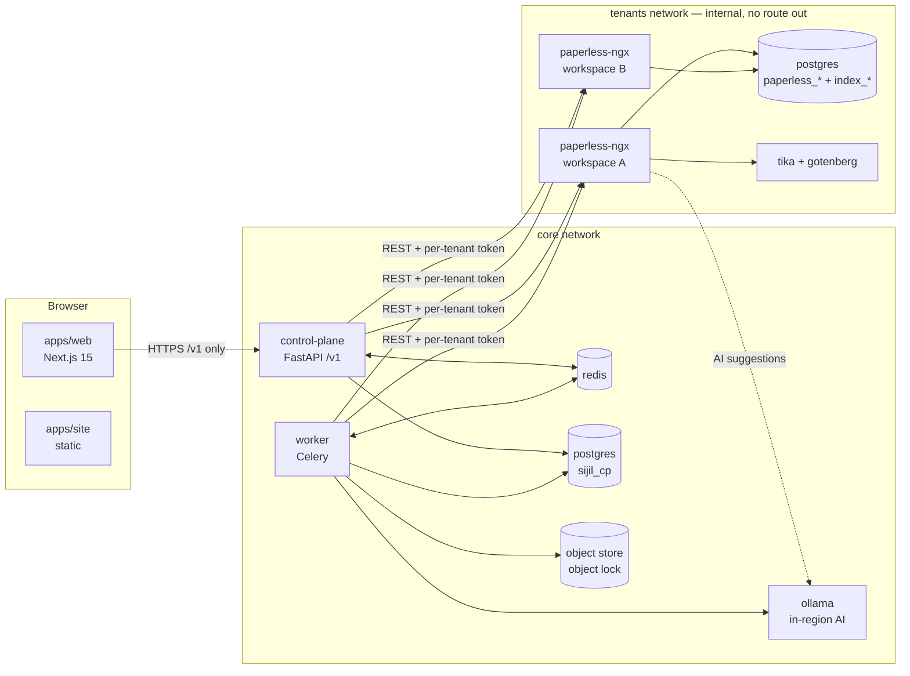
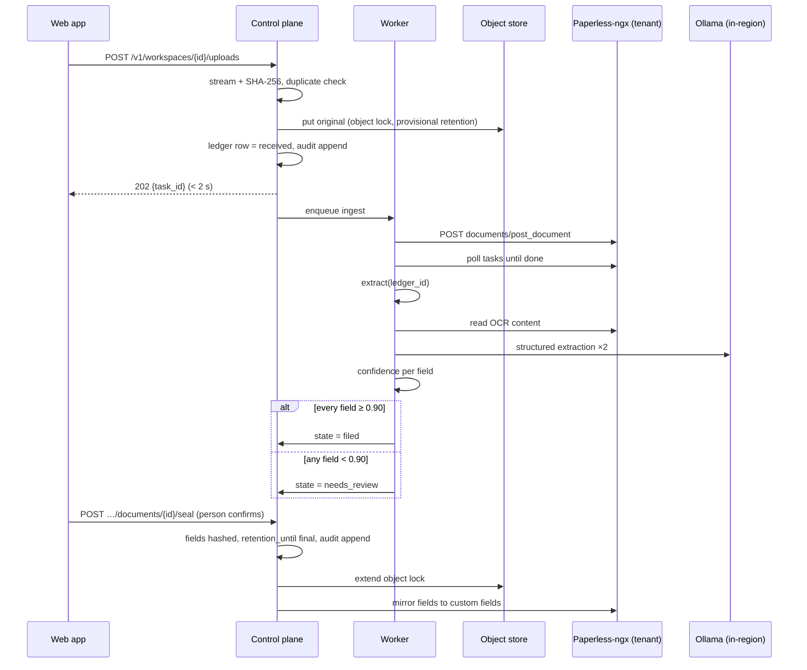

# Sijil architecture

This document describes how the pieces fit together. The *why* behind each decision is in the design ([docs/superpowers/specs/2026-10-31-sijil-mvp-design.md](superpowers/specs/2026-10-31-sijil-mvp-design.md)), and the build order is in [docs/plan.md](plan.md). Where this document and the code disagree, fix one of them.

## Components (one region)



| Component | Owns | Never does |
| --- | --- | --- |
| `apps/web` | UI, translation and RTL rendering | Talk to Paperless-ngx, hold document bytes beyond the current view |
| `control-plane` | Auth, sessions, orgs, workspaces, roles, ledger, audit log, retention, review, exports | Run long jobs (it enqueues them) |
| `worker` | Provisioning (`TenantRuntime`), ingest, task polling, hashing, extraction, drift check, export building | Serve HTTP to browsers |
| `sijil_core` | Settings, region guard, crypto, `PaperlessClient`, field parsers | Import `sijil_cp` or `sijil_worker` |
| Paperless-ngx (per workspace) | OCR, full-text search, original + archive files, matching, AI suggestions | Get modified: it is the official image, configured by environment variables only |

## Trust boundaries

1. **Browser → control plane.** This is the only way in: session cookie, CSRF, rate limits. Every `/v1/workspaces/{id}/…` route goes through, in order: authenticate, then `authorize(user, workspace, action)`, then `assert_region(workspace.region)`, then the handler, then an audit append.
2. **Control plane / worker → tenants network.** Only these two services sit on both networks. Tenants publish no ports (smoke-tested) and have no route out (smoke-tested), so a compromised tenant can't send data anywhere.
3. **Tenant → tenant.** Each tenant has its own database, volumes, Paperless secret key and API token. The control plane holds tokens encrypted with a per-tenant data key, and never lends a token to the browser.

## Where data lives

| Store | Shared? | Holds | Document content? |
| --- | --- | --- | --- |
| `sijil_cp` (Postgres) | Shared per region | Users, orgs, workspaces, memberships, sessions, encrypted tenant credentials, `DocumentLedger` (hashes, states, retention dates), `AuditEvent` | **No** (hashes and metadata only) |
| `index_<ws>` (Postgres + pgvector) | Per workspace | Extracted field values, correction notes, OCR-derived text for Ask, embeddings | Yes |
| `paperless_<ws>` (Postgres) + tenant volumes | Per workspace | Paperless metadata, OCR text, original + archived PDFs (a working copy) | Yes |
| Object store (`sijil-originals`) | Per region, one prefix per workspace | Write-once original of every ingested file, key = SHA-256, object lock until `retention_until` | Yes (the record of truth for files) |
| Redis | Per region | Job queues and results | Transient job arguments only (ids, never file bytes) |

## Document lifecycle



States: `received → needs_review | filed → sealed`. A document can also become `removed` (a tombstone row), but only before sealing, only by an Owner, and only with a stated reason.

## Retention lock: four layers

| # | Layer | Stops |
| --- | --- | --- |
| 1 | Control-plane API refuses with `409 retention.locked` | Every UI and API path we build |
| 2 | Paperless service user has no delete permission | Anyone holding the per-tenant token |
| 3 | Database trigger on `document_ledger` rejects changes to sealed rows and all row deletes | Bugs in our own code, direct SQL as the app role |
| 4 | Object lock (compliance mode) on the original | Anything touching storage. A nightly drift check catches changes made inside Paperless-ngx |

Every one of these has its own test in `tests/retention/` (M4). A new code path that can change or delete a document must add itself to that suite.

## Audit chain

```
hash_n = sha256( prev_hash_n ‖ canonical_json(event_n) )
prev_hash_0 = "0" × 64
canonical_json = sorted keys, no whitespace, UTF-8, timestamps ISO-8601 UTC with "Z"
```

- There is one chain per workspace. Appends take a per-workspace Postgres advisory lock, so concurrent writers can't fork the chain.
- The app's database role has `INSERT` and `SELECT` on `audit_event`, and a trigger rejects `UPDATE` and `DELETE`.
- `sijil-cp audit verify --workspace <id>` walks the chain. Export integrity reports include the chain head.

## Region enforcement

- Every service starts with `SIJIL_REGION`. Settings won't load without it (`sijil_core.settings.CoreSettings`).
- `Organisation.region` is set at signup and can't be changed (DB trigger + API `409 org.region_immutable`, M1).
- Every workspace-scoped request and job calls `sijil_core.region.assert_region(workspace.region, settings)`, which raises `RegionMismatch` (`region.mismatch`).
- AI and OCR endpoints are in-region services only (the compose `ollama` and Paperless's Tesseract). Tests assert that extraction calls no other host (M3).
- Tests run a fake second region (`eu-fra`) to prove that cross-region access is refused.

## `TenantRuntime` lifecycle (M1)

```
provision(workspace) → creates databases paperless_<ws> + index_<ws>, volumes, container on `tenants`
                     → waits for health → creates service user (view/add/change, no delete)
                       and read-only support user → takes token → stores it encrypted
                     → workspace.state = active
start / stop         → hibernate idle tenants (spec: after 30 min; post-MVP)
status               → provisioning | active | hibernated | closing | error
destroy              → only after closure rules allow it (design §5.4)
```

`DockerRuntime` drives the Docker Engine API in development. A Kubernetes implementation of the same interface comes with the production milestone.

## Local development

`make up` boots the stack in `infra/compose/`. The two sample tenants (`paperless-t1`, `paperless-t2`) exist so the stack can be demoed straight away, and real signups provision their own. `make smoke` checks:

- the control plane is ready and in region `ma-cas`;
- both tenants answer from inside, have no published port, have Arabic OCR and have no route out;
- Ollama, the object store and the worker all answer.

The object store in development is RustFS (Apache-2.0, S3 API with object lock). MinIO stopped publishing images in 2025. Production uses the region's own object storage behind the same `ObjectStore` interface.
